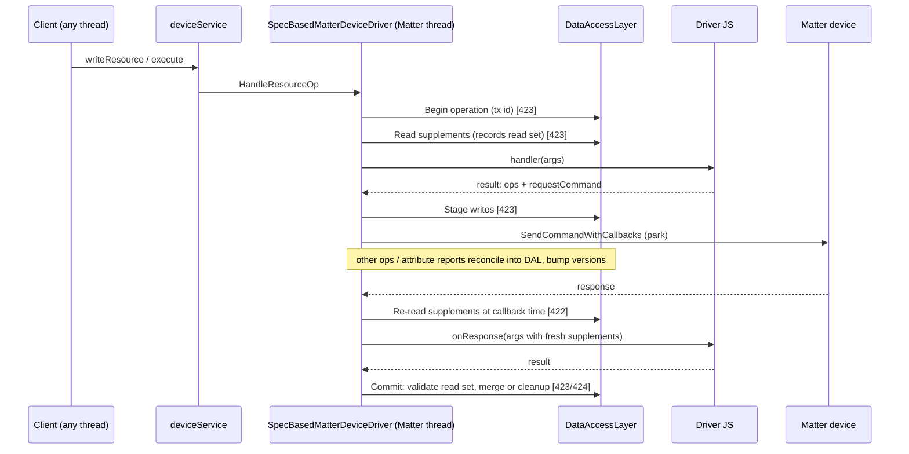

# Design: SBMD Data Access Layer — core versioned store and live-update reconciliation (BARTON-421, epic BARTON-420)

This document is the **foundation architecture design for the whole BARTON-420 epic**. It fully specifies the core store delivered by BARTON-421 and lays out the architecture, invariants, and extension points that BARTON-422 (driver API), BARTON-423 (optimistic transactions), BARTON-424 (cleanup hooks), and BARTON-425 (driver migration) build on. Those changes reference this document rather than restating it.

## Context

SBMD drivers are JavaScript bundles executed by the mquickjs runtime (`core/deviceDrivers/matter/sbmd/mquickjs/MQuickJsRuntime.*`) on behalf of `SpecBasedMatterDeviceDriver` (`core/deviceDrivers/matter/sbmd/SpecBasedMatterDeviceDriver.*`). A handler receives `args`, optionally pre-populated with `args.supplements`, and returns a `Sbmd.result()` chain that `SbmdResultExecutor` parses into non-terminal ops (`updateResource`, `setMetadata`, `setPersistentData`, `setTransientData`, `log`) and a terminal (`success`, `error`, `sendCommand`, `writeAttribute`, `requestCommand`, `readAttribute`).

Today, data access is spread over four unversioned sources, each with its own ad hoc accessor:

| Source | Read path today | Write path today |
| --- | --- | --- |
| Matter attribute cache | `SpecBasedMatterDeviceDriver::MakeAttrFetcher` → `MatterDevice::GetCachedAttributeData` | Device reports via `MatterDevice` cache callback → `HandleAttributeReport` |
| Barton resources | `MakeResFetcher` → `deviceServiceGetResourceById` | `updateResource` (`core/src/deviceService.c`), `deviceServiceWriteResource` |
| SBMD persistent data | `MakePersistFetcher` → `deviceServiceGetMetadata("/devices/<uuid>/metadata/sbmd.<key>")` | `setPersistentData` op → `deviceServiceSetMetadata` |
| SBMD transient data | `MakeTransientFetcher` → `GetTransientData` → `transientStore` | `setTransientData` op → `MakeTransientSetter` → `SetTransientData` |

Supplements are materialized once by `SbmdHandlerInvoker::FetchSupplements` before the handler runs. When the handler returns `requestCommand`, `ExecuteRequestCommand` emplaces a `PendingOperation` into `pendingOperations`, sends the command via `MatterDevice::SendCommandWithCallbacks`, and parks the caller on a `std::promise<bool>`. The parking blocks the *calling* thread, not the Matter event loop; the response is delivered to `HandleDeferredCommandResponse` on the Matter thread, which invokes the stored `onResponse` with `args.handlerContext` (the driver's `context` snapshot) and no supplements. Any other driver operation for the same device can run on the Matter thread in between — there is no per-device serialization.

The header comment on `transientStore` documents the thread-confinement invariant: `transientStore`, `pendingOperations`, `nextPendingId`, and `skippedOptionalResources` are touched only from the Matter/CHIP event-loop thread. There is therefore no data race; the defect in BARTON-411 is a classic **lost update**: `camera.sbmd.js` reads `TD_SESSIONS` in `handleStream`/`handleCreateSession`, parks across `VideoStreamAllocate`, and `handleAllocateForSolicit` writes `JSON.stringify(ctx.sessions)` — the stale park-time snapshot — back over whatever `createSession`/`destroySession` did in between.

Separately, BARTON-412 identified that pre-send failures (`FailOperation` sites and `CompletePendingOperation(pendingId, false)` after `SendCommandWithCallbacks` returns false) never invoke the driver's `onError`, stranding persisted state. BARTON-412 is fixed independently and guarantees exactly-once `onError` on every failure path; this epic depends on that guarantee.

No `docs/dev/architecture.md` exists in the project. Architecture prose lives in `docs/SBMD.md` §2.

## References

- `docs/SBMD.md` §2 (Architecture), §4.12 (Supplements), §5.1 (Handler Arguments), §6.2 (Command with Response), §7.3 (Storage) — the current driver contract this design preserves.
- `openspec/specs/sbmd-v4-runtime/spec.md` — "Supplements pre-loading", "Result chain execution", and "Deferred operations" requirements that define today's runtime semantics.
- `openspec/specs/camera-session-lifecycle/spec.md` — the session lifecycle whose transient state is corrupted by BARTON-411.
- `openspec/specs/resource-model/spec.md` — Barton resource URI model and string-serialized values the resource namespace mirrors.
- [Matter SDK `chip::DeviceLayer::SystemLayer().ScheduleLambda`](https://github.com/project-chip/connectedhomeip/blob/master/src/system/SystemLayer.h) — the mechanism already used by `MatterDeviceDriver.cpp` to post work onto the Matter thread; reused for the DAL ingress.
- H. T. Kung and J. T. Robinson, "On Optimistic Methods for Concurrency Control" (ACM TODS, 1981) — the read-set/validate/commit model adopted in BARTON-423.
- [cppreference: `std::shared_ptr` atomic/ownership semantics](https://en.cppreference.com/w/cpp/memory/shared_ptr) — basis for shared immutable value handles.

## Goals / Non-Goals

**Goals:**

- A single C++ layer through which every SBMD driver data request flows, sitting between the JS runtime and all data sources (device, attribute cache, resources/properties, persistent data, transient data).
- An authoritative in-memory view that is kept current by reconciling live updates (attribute reports, resource and metadata writes from other subsystems and the public API, SBMD writes).
- Per-key monotonically increasing versions, enabling optimistic concurrency in BARTON-423.
- O(1) hash-indexed lookups; immutable shared value handles so large values (transient JSON) are never deep-copied on read.
- Zero locking on the Matter-thread hot path; mutexes only at cross-thread ingress.
- Strict separation of concerns: no DAL internals (versions, transactions, queues) appear in the driver-facing API in any change of this epic.
- Behavior-preserving re-plumbing of today's fetchers/setter in this story.

**Non-Goals:**

- Blocking locks or per-device mutual exclusion around driver operations.
- Changing what drivers see in this story (BARTON-422 does that).
- Durable storage changes; the persistent-data and resource backends remain `deviceService` metadata/resources.
- Making the DAL a general-purpose cache for non-SBMD drivers.

## Architecture

### Epic-wide layering

```text
                         Barton public API (BCoreClient, GObject, GLib main loop / caller threads)
                                              |
                                              v
   core/src/deviceService.c  (deviceServiceWriteResource / updateResource / deviceServiceSetMetadata)
            |  (any thread)                                         ^
            |  notify change                                        | write-through
            v                                                       |
 +----------------------------------------------------------------------------------------------+
 |                       SBMD Data Access Layer  (barton::sbmd::dal)                            |
 |                                                                                              |
 |   IngressQueue (std::mutex) ---ScheduleLambda--->  Matter thread only below this line         |
 |                                                                                              |
 |   +--------------------+   +---------------------+   +------------------+   +--------------+  |
 |   | DataStore          |   | TransactionManager  |   | CleanupRegistry  |   | ChangeObserver|  |
 |   | unordered_map      |   | read/write sets,    |   | compensations,   |   | fan-out       |  |
 |   | DataKey->Entry     |   | validate, merge     |   | exactly-once     |   | (metrics,     |  |
 |   | (version, value*)  |   | [BARTON-423]        |   | [BARTON-424]     |   |  future)      |  |
 |   +--------------------+   +---------------------+   +------------------+   +--------------+  |
 |        |  read-through / write-through                                                       |
 |   +---------------+ +----------------+ +--------------------+ +----------------------------+  |
 |   | AttributeCache| | ResourceSource | | PersistentData     | | (transient: DataStore is   |  |
 |   | Source        | | (deviceService)| | Source (metadata   | |  the system of record)     |  |
 |   | (MatterDevice)| |                | |  "sbmd." prefix)   | |                            |  |
 |   +---------------+ +----------------+ +--------------------+ +----------------------------+  |
 +----------------------------------------------------------------------------------------------+
            ^                                     ^
            | Read/Write/StageWrite (Matter thr.) | Reconcile(attribute report)
            |                                     |
 +-------------------------------+      +-------------------------------------------+
 | SpecBasedMatterDeviceDriver   |      | MatterDevice cache callback               |
 |  - supplements (fetchers)     |      |  -> HandleAttributeReport                 |
 |  - ExecuteOps / setters       |      +-------------------------------------------+
 |  - pendingOperations          |
 +-------------------------------+
            ^  driver intent only (read X, write Y, on-failure Z)
            |
 +-------------------------------+
 | mquickjs runtime + driver JS  |  (camera.sbmd.js, door-lock.sbmd.js, ...)
 +-------------------------------+
```

### Delivery by story

```text
BARTON-421 (this)   DataKey, VersionedValue, DataStore, sources, IngressQueue, reconciliation,
                    fetchers/setter re-plumbed. No driver-visible change.
BARTON-422          Driver API: fresh supplements on deferred callbacks; per-member/merge
                    transient writes (storage.mergeTransientData / deleteTransientMember).
BARTON-423          TransactionManager: per-operation read/write sets, staged writes,
                    commit-time validation, pre-park retry, post-park per-key merge.
BARTON-424          CleanupRegistry: storage/device cleanup hooks, exactly-once invocation
                    on failure / timeout / unmergeable conflict.
BARTON-425          Migrate camera.sbmd.js et al.; integration tests for BARTON-411/412.
```

### Where an operation's data flows (target end state)



## Decisions

### D1: A C++ DAL owns the authoritative in-memory view; JS never sees versions

**Decision:** Introduce `barton::sbmd::dal::DataAccessLayer`, owned one-per-process by `SpecBasedMatterDeviceDriver`'s shared state (one DAL shared by all SBMD driver instances, keyed by device UUID, because transient/persistent/resource keys are already device-scoped and a device belongs to exactly one driver). All supplement fetches and all non-terminal data ops go through it. The JS-facing API (`args.supplements.*`, `Sbmd.result().storage.*`, `dataModel.*`) remains intent-only: drivers read values and request writes; they never see versions, transaction IDs, or queues.

**Alternative considered:** Put version numbers in `args.supplements` and add compare-and-set ops to JS (`setTransientDataIfVersion`). Rejected — it leaks concurrency control into every driver, is easy to misuse, and makes driver code depend on DAL internals, violating the agreed separation of concerns.

**Alternative considered:** Fix BARTON-411 inside `camera.sbmd.js` only (re-read in callback). Impossible today (deferred callbacks get no supplements) and does not generalize.

**Trade-offs:** The DAL becomes a central component on the SBMD hot path, so its performance budget is strict (D4).

---

### D2: Non-blocking sequencing and optimistic concurrency, not locks

**Decision:** The DAL does not offer or use blocking locks around driver operations. All DAL state is Matter-thread-confined. Concurrency between interleaved driver operations is handled optimistically: versions are recorded on read and validated on commit (BARTON-423). Mutexes appear only at cross-thread ingress (D6).

A blocking lock is the wrong primitive here: every driver operation's callbacks run on the Matter thread. If operation A acquired a per-device lock, parked waiting for a device response, and operation B on the same thread tried to acquire that lock, B would block the Matter event loop, so A's response could never be delivered — a deadlock. A non-blocking "try-lock and queue" is effectively a per-resource sequencing queue, which is kept only as a possible fallback (see Open Questions).

**Alternative considered:** Per-device `std::mutex` held across the park. Rejected — deadlocks as above.

**Alternative considered:** Per-device FIFO serialization of all operations. Rejected as the default — it serializes unrelated resources (e.g., camera `stream` and `privacyMode`), turns a slow device into head-of-line blocking, and still needs timeout semantics. Retained as an open question for unmergeable keys only.

**Trade-offs:** Optimistic concurrency requires a merge story for conflicts that happen after device side effects (BARTON-423) and compensations when merge fails (BARTON-424).

---

### D3: Tagged, hashable `DataKey` covering four namespaces

**Decision:** A single key type with a namespace tag and a precomputed hash. Interning device UUIDs to a `uint32_t` `DeviceHandle` keeps keys small and hashing cheap.

```cpp
// core/deviceDrivers/matter/sbmd/dal/DataKey.h
#pragma once

#include <cstdint>
#include <functional>
#include <string>
#include <variant>

namespace barton::sbmd::dal
{
    /** Interned device identifier. 0 is reserved as invalid. */
    using DeviceHandle = uint32_t;

    enum class Namespace : uint8_t
    {
        Attribute = 1,  // Matter attribute cache
        Resource = 2,   // Barton resource value
        Persistent = 3, // SBMD persistent data (device metadata, "sbmd." prefix)
        Transient = 4,  // SBMD transient data (in-memory, TTL)
    };

    struct AttributePath
    {
        uint16_t endpointId;
        uint32_t clusterId;
        uint32_t attributeId;
        bool operator==(const AttributePath &) const = default;
    };

    struct ResourcePath
    {
        std::string endpointId; // empty for root (device-level) resources
        std::string resourceId;
        bool operator==(const ResourcePath &) const = default;
    };

    struct NamedKey
    {
        std::string name;
        bool operator==(const NamedKey &) const = default;
    };

    /**
     * Identity of one datum the DAL tracks. Immutable after construction; hash is computed once.
     */
    class DataKey
    {
    public:
        static DataKey Attribute(DeviceHandle device, uint16_t endpoint, uint32_t cluster, uint32_t attribute);
        static DataKey Resource(DeviceHandle device, std::string endpointId, std::string resourceId);
        static DataKey Persistent(DeviceHandle device, std::string name);
        static DataKey Transient(DeviceHandle device, std::string name);

        Namespace GetNamespace() const { return ns; }
        DeviceHandle GetDevice() const { return device; }
        const AttributePath *AsAttribute() const { return std::get_if<AttributePath>(&path); }
        const ResourcePath *AsResource() const { return std::get_if<ResourcePath>(&path); }
        const NamedKey *AsNamed() const { return std::get_if<NamedKey>(&path); }
        size_t Hash() const { return hash; }

        bool operator==(const DataKey &other) const
        {
            return hash == other.hash && ns == other.ns && device == other.device && path == other.path;
        }

    private:
        DataKey(Namespace ns, DeviceHandle device, std::variant<AttributePath, ResourcePath, NamedKey> path);
        size_t ComputeHash() const;

        Namespace ns;
        DeviceHandle device;
        std::variant<AttributePath, ResourcePath, NamedKey> path;
        size_t hash;
    };

    struct DataKeyHash
    {
        size_t operator()(const DataKey &k) const noexcept { return k.Hash(); }
    };
} // namespace barton::sbmd::dal
```

```cpp
// core/deviceDrivers/matter/sbmd/dal/DataKey.cpp (excerpt)
namespace barton::sbmd::dal
{
    namespace
    {
        inline void HashCombine(size_t &seed, size_t v)
        {
            seed ^= v + 0x9e3779b97f4a7c15ULL + (seed << 6) + (seed >> 2);
        }
    } // namespace

    size_t DataKey::ComputeHash() const
    {
        size_t seed = std::hash<uint8_t> {}(static_cast<uint8_t>(ns));
        HashCombine(seed, std::hash<uint32_t> {}(device));

        if (auto *a = std::get_if<AttributePath>(&path))
        {
            HashCombine(seed, a->endpointId);
            HashCombine(seed, a->clusterId);
            HashCombine(seed, a->attributeId);
        }
        else if (auto *r = std::get_if<ResourcePath>(&path))
        {
            HashCombine(seed, std::hash<std::string> {}(r->endpointId));
            HashCombine(seed, std::hash<std::string> {}(r->resourceId));
        }
        else
        {
            HashCombine(seed, std::hash<std::string> {}(std::get<NamedKey>(path).name));
        }

        return seed;
    }
} // namespace barton::sbmd::dal
```

**Alternative considered:** String keys built from URIs (`/devices/<uuid>/ep/1/r/stream`). Rejected — allocation and hashing of long strings on every lookup, and attribute paths have no natural URI.

**Trade-offs:** `DeviceHandle` interning needs a small `DeviceRegistry` (D5) and cleanup on device removal.

---

### D4: `VersionedValue` with immutable shared payloads and per-key monotonic versions

**Decision:** Each entry stores a `std::shared_ptr<const Value>` plus a `uint64_t version`. Reads hand out the shared pointer (refcount bump, no copy). Writes allocate a new immutable value and swap the pointer. Versions are per key, start at 1 on first materialization, and increase by exactly 1 on every committed change, including deletes (tombstones keep the version so that delete-then-recreate is detected). A global `uint64_t` epoch is *not* used, so unrelated keys never cause false conflicts.

```cpp
// core/deviceDrivers/matter/sbmd/dal/VersionedValue.h
#pragma once

#include <chrono>
#include <cstdint>
#include <memory>
#include <optional>
#include <string>
#include <vector>

namespace barton::sbmd::dal
{
    /**
     * Immutable payload. Attribute values are raw TLV bytes (as read from the cache); resource,
     * persistent, and transient values are strings (Barton resources are string-serialized).
     */
    struct Value
    {
        enum class Kind : uint8_t
        {
            String,
            Tlv
        };

        Kind kind = Kind::String;
        std::string text;          // Kind::String
        std::vector<uint8_t> tlv;  // Kind::Tlv
    };

    using ValueHandle = std::shared_ptr<const Value>;

    using Version = uint64_t;
    inline constexpr Version kAbsentVersion = 0; // key never materialized

    /** Snapshot returned to callers. Cheap to copy (one shared_ptr + scalars). */
    struct VersionedValue
    {
        ValueHandle value; // nullptr == absent / deleted / expired
        Version version = kAbsentVersion;
        bool IsPresent() const { return value != nullptr; }
    };

    /** Internal store entry. */
    struct Entry
    {
        ValueHandle value;
        Version version = kAbsentVersion;
        std::optional<std::chrono::steady_clock::time_point> expiry; // transient TTL only
        bool hydrated = false; // true once loaded from (or authoritative over) the backing source
    };

    inline ValueHandle MakeString(std::string s)
    {
        auto v = std::make_shared<Value>();
        v->kind = Value::Kind::String;
        v->text = std::move(s);
        return v;
    }

    inline ValueHandle MakeTlv(std::vector<uint8_t> bytes)
    {
        auto v = std::make_shared<Value>();
        v->kind = Value::Kind::Tlv;
        v->tlv = std::move(bytes);
        return v;
    }
} // namespace barton::sbmd::dal
```

Because values are immutable, a reader that captured a `ValueHandle` before a write keeps a consistent snapshot without copying, and the writer never mutates shared memory. This is copy-on-write at value granularity. Member-level (JSON field) structural sharing is not needed for the sizes involved (camera `TD_SESSIONS` is a few hundred bytes to a few KB).

**Alternative considered:** Store `cJSON*` trees for transient values to support per-member edits. Rejected for the store itself — cJSON trees are mutable and not shareable; member merge (BARTON-422/423) parses on demand and writes a new immutable string.

**Alternative considered:** Hybrid logical clocks / global sequence number. Rejected — unnecessary for single-thread confinement and causes false conflicts.

**Trade-offs:** Every write allocates. Acceptable: SBMD writes are low-frequency compared to attribute reads.

---

### D5: `DataStore` — Matter-thread-confined `unordered_map` with no hot-path locking

**Decision:** The store is a plain `std::unordered_map<DataKey, Entry, DataKeyHash>` with a debug-only thread-owner assertion. It is never accessed off the Matter thread. A secondary index `device → vector<DataKey>` supports O(k) device removal.

```cpp
// core/deviceDrivers/matter/sbmd/dal/DataStore.h
#pragma once

#include "DataKey.h"
#include "VersionedValue.h"

#include <functional>
#include <string>
#include <thread>
#include <unordered_map>
#include <unordered_set>

namespace barton::sbmd::dal
{
    /** Interns device UUID strings to compact handles. Matter-thread-confined. */
    class DeviceRegistry
    {
    public:
        DeviceHandle Intern(const std::string &deviceUuid);
        std::optional<DeviceHandle> Find(const std::string &deviceUuid) const;
        const std::string &Uuid(DeviceHandle handle) const;
        void Forget(DeviceHandle handle);

    private:
        std::unordered_map<std::string, DeviceHandle> byUuid;
        std::unordered_map<DeviceHandle, std::string> byHandle;
        DeviceHandle next = 1;
    };

    enum class ChangeOrigin : uint8_t
    {
        DeviceReport,    // Matter attribute report / subscription
        Driver,          // SBMD driver write (ops or commit)
        DeviceService,   // updateResource / metadata from non-SBMD code paths
        PublicApi,       // client write via deviceServiceWriteResource
        Expiry,          // transient TTL expiry
        Hydration,       // first load from backing source (does not bump version past 1)
    };

    struct ChangeRecord
    {
        const DataKey &key;
        Version oldVersion;
        Version newVersion;
        ChangeOrigin origin;
    };

    using ChangeObserver = std::function<void(const ChangeRecord &)>;

    /**
     * Authoritative versioned view. All methods must be called on the Matter thread; enforced by
     * AssertOwner() in debug builds. No internal locking.
     */
    class DataStore
    {
    public:
        DataStore();

        /** O(1). Returns kAbsentVersion/nullptr for unknown, deleted, or expired keys. */
        VersionedValue Get(const DataKey &key, std::chrono::steady_clock::time_point now);

        /** Peek the entry without expiry processing (for hydration decisions). */
        const Entry *Find(const DataKey &key) const;

        /**
         * Replace the value and bump the version by one. Passing nullptr deletes (tombstone).
         * No-op (no bump) when the new value is byte-equal to the current one, matching Barton's
         * same-value suppression downstream.
         * Returns the resulting version.
         */
        Version Put(const DataKey &key,
                    ValueHandle value,
                    ChangeOrigin origin,
                    std::optional<std::chrono::steady_clock::time_point> expiry = std::nullopt);

        /** Load a value from a backing source without creating a conflicting version bump. */
        Version Hydrate(const DataKey &key, ValueHandle value);

        /** Mark a key stale so the next Get re-hydrates; bumps the version (unknown new value). */
        Version Invalidate(const DataKey &key, ChangeOrigin origin);

        /** Remove all keys for a device (device removed / driver unloaded). */
        void EraseDevice(DeviceHandle device);

        void SetObserver(ChangeObserver observer) { this->observer = std::move(observer); }

        size_t Size() const { return entries.size(); }

    private:
        void AssertOwner() const;
        static bool Equal(const ValueHandle &a, const ValueHandle &b);
        void Notify(const DataKey &key, Version oldV, Version newV, ChangeOrigin origin);

        std::unordered_map<DataKey, Entry, DataKeyHash> entries;
        std::unordered_map<DeviceHandle, std::unordered_set<DataKey, DataKeyHash>> byDevice;
        ChangeObserver observer;
        std::thread::id owner; // captured lazily on first call; debug assertion only
    };
} // namespace barton::sbmd::dal
```

```cpp
// core/deviceDrivers/matter/sbmd/dal/DataStore.cpp (core methods)
#include "DataStore.h"

#include <cassert>

namespace barton::sbmd::dal
{
    VersionedValue DataStore::Get(const DataKey &key, std::chrono::steady_clock::time_point now)
    {
        AssertOwner();
        auto it = entries.find(key);

        if (it == entries.end())
        {
            return {};
        }

        Entry &e = it->second;

        if (e.expiry.has_value() && now >= *e.expiry && e.value != nullptr)
        {
            Version old = e.version;
            e.value.reset();
            e.expiry.reset();
            e.version++;
            Notify(key, old, e.version, ChangeOrigin::Expiry);
        }

        return VersionedValue {e.value, e.version};
    }

    Version DataStore::Put(const DataKey &key,
                           ValueHandle value,
                           ChangeOrigin origin,
                           std::optional<std::chrono::steady_clock::time_point> expiry)
    {
        AssertOwner();
        auto [it, inserted] = entries.try_emplace(key);
        Entry &e = it->second;

        if (inserted)
        {
            byDevice[key.GetDevice()].insert(key);
        }

        if (!inserted && e.hydrated && Equal(e.value, value))
        {
            e.expiry = expiry; // TTL refresh without a logical change
            return e.version;
        }

        Version old = e.version;
        e.value = std::move(value);
        e.expiry = expiry;
        e.hydrated = true;
        e.version++;
        Notify(key, old, e.version, origin);
        return e.version;
    }

    Version DataStore::Hydrate(const DataKey &key, ValueHandle value)
    {
        AssertOwner();
        auto [it, inserted] = entries.try_emplace(key);
        Entry &e = it->second;

        if (inserted)
        {
            byDevice[key.GetDevice()].insert(key);
        }

        if (!e.hydrated)
        {
            e.value = std::move(value);
            e.hydrated = true;
            if (e.version == kAbsentVersion)
            {
                e.version = 1;
            }
        }

        return e.version;
    }

    Version DataStore::Invalidate(const DataKey &key, ChangeOrigin origin)
    {
        AssertOwner();
        auto it = entries.find(key);

        if (it == entries.end())
        {
            return kAbsentVersion;
        }

        Version old = it->second.version;
        it->second.hydrated = false;
        it->second.value.reset();
        it->second.version++;
        Notify(key, old, it->second.version, origin);
        return it->second.version;
    }

    void DataStore::EraseDevice(DeviceHandle device)
    {
        AssertOwner();
        auto it = byDevice.find(device);

        if (it == byDevice.end())
        {
            return;
        }

        for (const DataKey &k : it->second)
        {
            entries.erase(k);
        }

        byDevice.erase(it);
    }

    bool DataStore::Equal(const ValueHandle &a, const ValueHandle &b)
    {
        if (a == b)
        {
            return true;
        }
        if (!a || !b || a->kind != b->kind)
        {
            return false;
        }
        return a->kind == Value::Kind::String ? a->text == b->text : a->tlv == b->tlv;
    }

    void DataStore::Notify(const DataKey &key, Version oldV, Version newV, ChangeOrigin origin)
    {
        if (observer)
        {
            observer(ChangeRecord {key, oldV, newV, origin});
        }
    }

    void DataStore::AssertOwner() const
    {
#ifndef NDEBUG
        // owner is set by DataAccessLayer::BindToMatterThread(); see D6.
        assert(owner == std::thread::id {} || owner == std::this_thread::get_id());
#endif
    }
} // namespace barton::sbmd::dal
```

**Alternative considered:** `std::shared_mutex` around the map for concurrent readers. Rejected — every reader is already on the Matter thread; the mutex would add cost and invite holding it across a park.

**Alternative considered:** A concurrent hash map (e.g., `folly::ConcurrentHashMap`). Rejected — new heavyweight dependency with no benefit under confinement.

**Trade-offs:** Callers on other threads must go through `IngressQueue`, adding one Matter-loop hop of latency for cross-thread writes.

---

### D6: `IngressQueue` — the only mutex, posting to the Matter thread

**Decision:** Writers not on the Matter thread (GLib main loop, public API caller threads, deviceService worker threads) never touch `DataStore`. They enqueue a `ReconcileEvent` under a `std::mutex` and, if the queue transitioned from empty, post one drain task with `chip::DeviceLayer::SystemLayer().ScheduleLambda` (already used in `MatterDeviceDriver.cpp`). The drain runs on the Matter thread, swaps the queue out under the mutex, and applies events without holding the mutex. If the caller is already on the Matter thread (`chip::DeviceLayer::PlatformMgr().IsChipStackLockedByCurrentThread()` or the DAL's bound owner id), the event is applied synchronously so Matter-thread writers observe their own writes immediately.

```cpp
// core/deviceDrivers/matter/sbmd/dal/IngressQueue.h
#pragma once

#include "DataKey.h"
#include "DataStore.h"
#include "VersionedValue.h"

#include <functional>
#include <mutex>
#include <string>
#include <vector>

namespace barton::sbmd::dal
{
    /** A change produced outside the DAL that must be reconciled into the view. */
    struct ReconcileEvent
    {
        enum class Kind : uint8_t
        {
            ResourceChanged,   // value known
            MetadataChanged,   // value known (sbmd.* keys only)
            Invalidate,        // value unknown; re-hydrate on next read
            DeviceRemoved,
        };

        Kind kind;
        std::string deviceUuid;
        std::string endpointId;  // ResourceChanged
        std::string name;        // resourceId or metadata key (without "sbmd." prefix)
        std::optional<std::string> value; // nullopt == deleted
        ChangeOrigin origin = ChangeOrigin::DeviceService;
    };

    class IngressQueue
    {
    public:
        using Applier = std::function<void(ReconcileEvent &&)>;
        using Poster = std::function<bool(std::function<void()>)>; // posts to Matter thread
        using OnOwnerThread = std::function<bool()>;

        IngressQueue(Applier applier, Poster poster, OnOwnerThread onOwnerThread);

        /** Thread-safe. Applies inline when already on the Matter thread. */
        void Submit(ReconcileEvent event);

        /** Matter thread only. Drains everything queued so far. */
        void Drain();

        size_t Depth();

    private:
        Applier applier;
        Poster poster;
        OnOwnerThread onOwnerThread;

        std::mutex mutex;              // guards pending + drainScheduled only
        std::vector<ReconcileEvent> pending;
        bool drainScheduled = false;
    };
} // namespace barton::sbmd::dal
```

```cpp
// core/deviceDrivers/matter/sbmd/dal/IngressQueue.cpp
#include "IngressQueue.h"

namespace barton::sbmd::dal
{
    IngressQueue::IngressQueue(Applier applier, Poster poster, OnOwnerThread onOwnerThread) :
        applier(std::move(applier)), poster(std::move(poster)), onOwnerThread(std::move(onOwnerThread))
    {
    }

    void IngressQueue::Submit(ReconcileEvent event)
    {
        if (onOwnerThread())
        {
            Drain(); // preserve FIFO order relative to earlier cross-thread submissions
            applier(std::move(event));
            return;
        }

        bool schedule = false;
        {
            std::lock_guard<std::mutex> lock(mutex);
            pending.push_back(std::move(event));
            if (!drainScheduled)
            {
                drainScheduled = true;
                schedule = true;
            }
        }

        if (schedule && !poster([this]() { Drain(); }))
        {
            std::lock_guard<std::mutex> lock(mutex);
            drainScheduled = false; // retried on next Submit; logged by caller
        }
    }

    void IngressQueue::Drain()
    {
        std::vector<ReconcileEvent> batch;
        {
            std::lock_guard<std::mutex> lock(mutex);
            batch.swap(pending);
            drainScheduled = false;
        }

        for (auto &ev : batch)
        {
            applier(std::move(ev));
        }
    }

    size_t IngressQueue::Depth()
    {
        std::lock_guard<std::mutex> lock(mutex);
        return pending.size();
    }
} // namespace barton::sbmd::dal
```

**Alternative considered:** Lock-free MPSC queue. Rejected for now — contention is negligible; a `std::mutex` held for a `push_back` is simpler and auditable.

**Trade-offs:** Cross-thread writes become visible to drivers one Matter-loop turn later. A driver handler already running on the Matter thread cannot observe a not-yet-drained external write; that is equivalent to the write having happened slightly later and is caught by version validation in BARTON-423.

---

### D7: Data sources are read-through adapters; transient data is DAL-native

**Decision:** Each namespace except transient has a `DataSource` that knows how to hydrate a key on miss and how to write through on commit. Transient data has no backing source: `DataStore` *is* the system of record and `SpecBasedMatterDeviceDriver::transientStore` / `TransientEntry` are removed.

```cpp
// core/deviceDrivers/matter/sbmd/dal/DataSource.h
#pragma once

#include "DataKey.h"
#include "VersionedValue.h"

#include <optional>
#include <string>

namespace barton::sbmd::dal
{
    class DataSource
    {
    public:
        virtual ~DataSource() = default;

        /** Matter thread. Load the current backing value, or nullopt if absent. */
        virtual std::optional<ValueHandle> Load(const DataKey &key, const std::string &deviceUuid) = 0;

        /**
         * Matter thread. Write a committed value to the backing store. Returns false on failure.
         * Sources whose writes re-enter the DAL via a change hook (ResourceSource) must suppress
         * the echo; see ResourceSource::Store.
         */
        virtual bool Store(const DataKey &key, const std::string &deviceUuid, const ValueHandle &value) = 0;
    };
} // namespace barton::sbmd::dal
```

```cpp
// core/deviceDrivers/matter/sbmd/dal/AttributeCacheSource.h
#pragma once

#include "DataSource.h"
#include "matter/MatterDevice.h"

#include <functional>
#include <memory>

namespace barton::sbmd::dal
{
    /** Reads Matter attributes from MatterDevice's ClusterStateCache. Store() is unsupported (attributes
     * are written to the device via writeAttribute terminals, not via the DAL). */
    class AttributeCacheSource final : public DataSource
    {
    public:
        using DeviceLookup = std::function<std::shared_ptr<barton::MatterDevice>(const std::string &uuid)>;
        explicit AttributeCacheSource(DeviceLookup lookup) : lookup(std::move(lookup)) {}

        std::optional<ValueHandle> Load(const DataKey &key, const std::string &deviceUuid) override
        {
            auto device = lookup(deviceUuid);
            const AttributePath *p = key.AsAttribute();
            if (!device || p == nullptr)
            {
                return std::nullopt;
            }

            chip::TLV::TLVReader reader;
            if (device->GetCachedAttributeData(p->endpointId, p->clusterId, p->attributeId, reader) != CHIP_NO_ERROR)
            {
                return std::nullopt;
            }

            std::vector<uint8_t> bytes;
            if (!CopyTlvElement(reader, bytes)) // same helper EncodeTlvElementToBase64 uses, minus base64
            {
                return std::nullopt;
            }
            return MakeTlv(std::move(bytes));
        }

        bool Store(const DataKey &, const std::string &, const ValueHandle &) override { return false; }

    private:
        static bool CopyTlvElement(chip::TLV::TLVReader &reader, std::vector<uint8_t> &out);
        DeviceLookup lookup;
    };
} // namespace barton::sbmd::dal
```

`ResourceSource` wraps `deviceServiceGetResourceById` (load) and `updateResource` (store); `PersistentDataSource` wraps `deviceServiceGetMetadata` / `deviceServiceSetMetadata` with the URI `"/devices/" + uuid + "/metadata/sbmd." + key` exactly as `SpecBasedMatterDeviceDriver.cpp` builds it today. Both set a thread-local `suppressEcho` flag around the store call so the change hook (D8) does not re-apply the DAL's own write as a foreign change.

```cpp
// core/deviceDrivers/matter/sbmd/dal/ResourceSource.cpp (excerpt)
namespace barton::sbmd::dal
{
    thread_local bool ResourceSource::suppressEcho = false;

    std::optional<ValueHandle> ResourceSource::Load(const DataKey &key, const std::string &deviceUuid)
    {
        const ResourcePath *p = key.AsResource();
        icDeviceResource *res = deviceServiceGetResourceById(
            deviceUuid.c_str(), p->endpointId.empty() ? nullptr : p->endpointId.c_str(), p->resourceId.c_str());

        if (res == nullptr)
        {
            return std::nullopt;
        }

        ValueHandle v = res->value ? MakeString(res->value) : nullptr;
        resourceDestroy(res);
        return v;
    }

    bool ResourceSource::Store(const DataKey &key, const std::string &deviceUuid, const ValueHandle &value)
    {
        const ResourcePath *p = key.AsResource();
        suppressEcho = true;
        updateResource(deviceUuid.c_str(),
                       p->endpointId.empty() ? nullptr : p->endpointId.c_str(),
                       p->resourceId.c_str(),
                       value ? value->text.c_str() : nullptr,
                       nullptr);
        suppressEcho = false;
        return true;
    }
} // namespace barton::sbmd::dal
```

**Alternative considered:** Mirror every resource into the DAL eagerly at device load. Rejected — memory cost for resources no driver reads; lazy hydration on first read is sufficient because the change hook keeps hydrated keys current.

**Trade-offs:** Attribute-cache freshness is only as good as the subscription (see Open Questions: cache vs device freshness).

---

### D8: Live-update reconciliation hooks

**Decision:** Every path that changes a datum the DAL may hold notifies the DAL:

| Origin | Hook point | Thread | Event |
| --- | --- | --- | --- |
| Matter attribute report | `SpecBasedMatterDeviceDriver::HandleAttributeReport` (called from `MatterDevice` cache callback) — before dispatching to driver handlers | Matter | `DataStore::Put(Attribute, tlv, DeviceReport)` inline |
| Resource write from any C code | `updateResource` in `core/src/deviceService.c`, after the value is stored and only if it changed | any | `IngressQueue::Submit(ResourceChanged)` |
| Public API write | `deviceServiceWriteResource` → driver `writeResource` → `updateResource` | caller | covered by `updateResource` hook |
| Metadata write | `deviceServiceSetMetadata` for keys starting with `sbmd.` | any | `IngressQueue::Submit(MetadataChanged)` |
| SBMD driver ops | `SbmdHandlerInvoker::ExecuteOps` (`updateResource`, `setPersistentData`, `setTransientData`) | Matter | `DataAccessLayer::Write` inline |
| Transient TTL | `DataStore::Get` lazily | Matter | `Expiry` |
| Device removed | `SpecBasedMatterDeviceDriver` device removal / `deviceServiceRemoveDevice` | any | `IngressQueue::Submit(DeviceRemoved)` |

The C side gets a narrow, internal, C-linkage registration so `deviceService.c` has no C++ dependency:

```c
/* core/src/sbmdDataObserver.h  (internal, not installed) */
#pragma once

#include <stdbool.h>

typedef enum
{
    SBMD_DATA_CHANGE_RESOURCE = 1,
    SBMD_DATA_CHANGE_METADATA = 2,
    SBMD_DATA_CHANGE_DEVICE_REMOVED = 3,
} SbmdDataChangeKind;

typedef void (*SbmdDataChangeCallback)(SbmdDataChangeKind kind,
                                       const char *deviceUuid,
                                       const char *endpointId, /* NULL for root / metadata */
                                       const char *name,       /* resourceId or metadata key */
                                       const char *value);     /* NULL == deleted */

/* Installed once by the SBMD runtime when BCORE_MATTER is enabled. Thread-safe. */
void sbmdDataObserverSet(SbmdDataChangeCallback callback);

/* Called by deviceService. No-op when no observer is installed. */
void sbmdDataObserverNotify(SbmdDataChangeKind kind,
                            const char *deviceUuid,
                            const char *endpointId,
                            const char *name,
                            const char *value);
```

The callback converts to a `ReconcileEvent` and calls `IngressQueue::Submit`. `ResourceSource::suppressEcho` (thread-local) causes the callback to drop echoes of DAL-originated writes. Because the hook is in `updateResource` itself, writers that bypass the SBMD runtime but go through deviceService are captured automatically; writers that bypass deviceService entirely are an open question.

**Alternative considered:** Subscribe to `BCoreClient` `resource-updated` GObject signals. Rejected — those are delivered asynchronously on the GLib main loop after event production, adding latency and coupling the core to its own public API.

**Trade-offs:** `updateResource` gains one function-pointer check on every call (negligible).

---

### D9: `DataAccessLayer` façade and behavior-preserving re-plumbing

**Decision:** A single façade exposes Matter-thread `Read`/`Write` plus ingress, and the existing fetcher factories delegate to it. This story keeps semantics identical: supplements are still fetched once before the handler; `setTransientData` still writes whole values with TTL.

```cpp
// core/deviceDrivers/matter/sbmd/dal/DataAccessLayer.h
#pragma once

#include "DataKey.h"
#include "DataSource.h"
#include "DataStore.h"
#include "IngressQueue.h"

#include <chrono>
#include <memory>
#include <optional>
#include <string>

namespace barton::sbmd::dal
{
    struct DalMetrics
    {
        uint64_t reads = 0;
        uint64_t hydrations = 0;
        uint64_t writes = 0;
        uint64_t reconciliations = 0;
        uint64_t expiries = 0;
    };

    /**
     * Single entry point for SBMD driver data access. All non-ingress methods are Matter-thread-only.
     * BARTON-423 adds BeginOperation/Commit/Abort; BARTON-424 adds cleanup registration. Neither
     * changes the methods below.
     */
    class DataAccessLayer
    {
    public:
        struct Sources
        {
            std::unique_ptr<DataSource> attributes;
            std::unique_ptr<DataSource> resources;
            std::unique_ptr<DataSource> persistent;
        };

        DataAccessLayer(Sources sources, IngressQueue::Poster poster, IngressQueue::OnOwnerThread onOwner);

        /** Bind the owning thread for debug assertions; called from the Matter thread at startup. */
        void BindToMatterThread();

        // ---- Matter thread ----
        VersionedValue Read(const std::string &deviceUuid, const DataKey &key);
        Version Write(const std::string &deviceUuid,
                      const DataKey &key,
                      ValueHandle value,
                      ChangeOrigin origin,
                      std::optional<std::chrono::seconds> ttl = std::nullopt);
        void ReconcileAttribute(const std::string &deviceUuid,
                                uint16_t endpoint,
                                uint32_t cluster,
                                uint32_t attribute,
                                std::vector<uint8_t> tlv);

        DeviceHandle Device(const std::string &deviceUuid) { return registry.Intern(deviceUuid); }

        // ---- any thread ----
        IngressQueue &Ingress() { return ingress; }

        const DalMetrics &Metrics() const { return metrics; }
        DataStore &Store() { return store; } // for TransactionManager (BARTON-423) and tests

    private:
        void Apply(ReconcileEvent &&ev);
        DataSource *SourceFor(Namespace ns);

        Sources sources;
        DeviceRegistry registry;
        DataStore store;
        IngressQueue ingress;
        DalMetrics metrics;
    };
} // namespace barton::sbmd::dal
```

```cpp
// core/deviceDrivers/matter/sbmd/dal/DataAccessLayer.cpp (core methods)
namespace barton::sbmd::dal
{
    VersionedValue DataAccessLayer::Read(const std::string &deviceUuid, const DataKey &key)
    {
        metrics.reads++;
        auto now = std::chrono::steady_clock::now();
        const Entry *e = store.Find(key);

        if ((e == nullptr || !e->hydrated) && key.GetNamespace() != Namespace::Transient)
        {
            if (DataSource *src = SourceFor(key.GetNamespace()))
            {
                auto loaded = src->Load(key, deviceUuid);
                store.Hydrate(key, loaded.value_or(nullptr));
                metrics.hydrations++;
            }
        }

        return store.Get(key, now);
    }

    Version DataAccessLayer::Write(const std::string &deviceUuid,
                                   const DataKey &key,
                                   ValueHandle value,
                                   ChangeOrigin origin,
                                   std::optional<std::chrono::seconds> ttl)
    {
        metrics.writes++;
        std::optional<std::chrono::steady_clock::time_point> expiry;

        if (ttl.has_value())
        {
            if (ttl->count() == 0 || value == nullptr)
            {
                value = nullptr; // ttl 0 == delete, matching today's setTransientData(key, '', 0)
            }
            else
            {
                expiry = std::chrono::steady_clock::now() + *ttl;
            }
        }

        if (DataSource *src = SourceFor(key.GetNamespace()))
        {
            if (!src->Store(key, deviceUuid, value))
            {
                return store.Find(key) ? store.Find(key)->version : kAbsentVersion;
            }
        }

        return store.Put(key, std::move(value), origin, expiry);
    }

    void DataAccessLayer::Apply(ReconcileEvent &&ev)
    {
        metrics.reconciliations++;
        DeviceHandle dev = registry.Intern(ev.deviceUuid);

        switch (ev.kind)
        {
            case ReconcileEvent::Kind::ResourceChanged:
                store.Put(DataKey::Resource(dev, ev.endpointId, ev.name),
                          ev.value ? MakeString(*ev.value) : nullptr,
                          ev.origin);
                break;
            case ReconcileEvent::Kind::MetadataChanged:
                store.Put(DataKey::Persistent(dev, ev.name), ev.value ? MakeString(*ev.value) : nullptr, ev.origin);
                break;
            case ReconcileEvent::Kind::Invalidate:
                store.Invalidate(DataKey::Resource(dev, ev.endpointId, ev.name), ev.origin);
                break;
            case ReconcileEvent::Kind::DeviceRemoved:
                store.EraseDevice(dev);
                registry.Forget(dev);
                break;
        }
    }
} // namespace barton::sbmd::dal
```

Re-plumbing in `SpecBasedMatterDeviceDriver.cpp`:

```cpp
// core/deviceDrivers/matter/sbmd/SpecBasedMatterDeviceDriver.cpp (replacement bodies)
TransientDataFetcher SpecBasedMatterDeviceDriver::MakeTransientFetcher(const std::string &deviceUuid)
{
    return [this, deviceUuid](const std::string &key) -> std::optional<std::string> {
        auto &dal = SbmdDal();
        auto vv = dal.Read(deviceUuid, dal::DataKey::Transient(dal.Device(deviceUuid), key));
        if (!vv.IsPresent())
        {
            return std::nullopt;
        }
        return vv.value->text;
    };
}

TransientDataSetter SpecBasedMatterDeviceDriver::MakeTransientSetter(const std::string &deviceUuid)
{
    return [deviceUuid](const std::string &key, const std::string &value, uint32_t ttlSecs) {
        auto &dal = SbmdDal();
        dal.Write(deviceUuid,
                  dal::DataKey::Transient(dal.Device(deviceUuid), key),
                  dal::MakeString(value),
                  dal::ChangeOrigin::Driver,
                  std::chrono::seconds(ttlSecs));
    };
}
```

`MakeAttrFetcher` resolves the alias exactly as today, then reads `DataKey::Attribute` and base64-encodes the TLV bytes; `MakeResFetcher` and `MakePersistFetcher` read `DataKey::Resource`/`DataKey::Persistent`. `SbmdHandlerInvoker::ExecuteOps` routes `updateResource` and `setPersistentData` through `DataAccessLayer::Write` (which writes through to deviceService) instead of calling deviceService directly.

**Alternative considered:** Replace the `std::function` fetcher types now. Rejected — larger blast radius; BARTON-422 changes the invoker contract deliberately.

---

## Thread Safety

The DAL extends, and makes explicit, the existing Matter-thread-confinement invariant documented on `transientStore`:

- **Matter event-loop thread (CHIP thread):** owns `DataStore`, `DeviceRegistry`, `pendingOperations`, and (BARTON-423/424) `TransactionManager` and `CleanupRegistry`. All driver handler dispatch (`HandleResourceOp`, `DispatchToHandlers`, `HandleDeferredCommandResponse`, `HandleDeferredCommandError`) already runs here. No locks are taken on reads or writes.
- **GLib main loop and public-API caller threads:** never touch DAL state directly. They reach the DAL only through `sbmdDataObserverNotify` → `IngressQueue::Submit`, which takes `IngressQueue::mutex` for a `push_back` and posts a drain with `SystemLayer().ScheduleLambda`.
- **mquickjs runtime mutex (`MQuickJsRuntime::GetMutex`)**: unchanged. It serializes JS engine access. DAL calls made while building supplements happen outside the JS mutex where possible (fetch first, then `AddSupplements` under the mutex, as `FetchSupplements` already does). The DAL never acquires the JS mutex, and the ingress mutex is never held while calling into the DAL or the JS engine, so there is no lock-order cycle.
- **Parking:** `ExecuteRequestCommand` parks the *calling* thread on `std::promise<bool>`; the Matter loop keeps running, so reconciliation and other driver operations continue to update the DAL during a park. This is exactly why per-key versions are needed and why blocking locks are rejected (D2).
- **Debug enforcement:** `DataStore::AssertOwner` asserts the bound Matter thread id in debug builds; unit tests run the DAL on a single test thread and bind it explicitly.

## Data Storage

In-memory only. `DataStore::entries` (`unordered_map<DataKey, Entry>`) and `byDevice` secondary index as defined in D5; `Entry` as defined in D4. Transient entries carry `expiry`. Persistent and resource namespaces remain durably stored by deviceService (JSON device files); the DAL holds a hydrated, versioned mirror. Nothing new is written to disk.

## Data Structures

Input structures: `ReconcileEvent` (D6) for cross-thread ingress; `DataKey` + `ValueHandle` + optional TTL for Matter-thread writes. Output structures: `VersionedValue` (D4) for reads; `ChangeRecord` (D5) for observers. Versions never cross into JS.

## Interfaces

### Internal C++ (Matter thread)

| Method | Description |
| --- | --- |
| `DataAccessLayer::Read(uuid, key)` | Current value + version; hydrates on miss. |
| `DataAccessLayer::Write(uuid, key, value, origin, ttl)` | Write-through + version bump. `ttl==0` or `value==nullptr` deletes. |
| `DataAccessLayer::ReconcileAttribute(...)` | Apply a Matter attribute report. |
| `DataStore::SetObserver(fn)` | Change fan-out (metrics; BARTON-423 conflict detection). |

### Internal C (any thread)

| Function | Description |
| --- | --- |
| `sbmdDataObserverSet(cb)` | Installed once by SBMD runtime init. |
| `sbmdDataObserverNotify(kind, uuid, ep, name, value)` | Called from `updateResource`, `deviceServiceSetMetadata`, device removal. |

### Driver-facing (JS)

No change in this story. Driver-facing changes are specified in BARTON-422 (`sbmd-dal-driver-api`), BARTON-423 has none by design, and BARTON-424 adds cleanup hooks.

### Public API / GObject

No change. No new `BCore*` types, signals, or properties; GIR output is unchanged. The public API remains backward compatible.

## Implementation Detail

1. Add `core/deviceDrivers/matter/sbmd/dal/` sources and wire them into the SBMD source list compiled under `BCORE_MATTER`.
2. Construct the DAL in the SBMD runtime initialization path (where `MQuickJsRuntime` is initialized), injecting `ScheduleLambda` as the poster and `PlatformMgr().IsChipStackLockedByCurrentThread()` as the owner check; call `BindToMatterThread()` from the first Matter-thread callback.
3. Add `core/src/sbmdDataObserver.{h,c}` with an atomic function pointer; call `sbmdDataObserverNotify` from `updateResource` (only on actual value change), `deviceServiceSetMetadata` (only `sbmd.`-prefixed keys), and device removal.
4. Re-plumb `MakeAttrFetcher`, `MakeResFetcher`, `MakePersistFetcher`, `MakeTransientFetcher`, `MakeTransientSetter`, and `ExecuteOps`; delete `transientStore`, `TransientEntry`, `SetTransientData`, `GetTransientData` (keep thin forwarding wrappers if `TestableSpecBasedMatterDeviceDriver` needs them).
5. Call `DataAccessLayer::ReconcileAttribute` at the top of `HandleAttributeReport`.
6. Export `DalMetrics` through the existing SBMD metrics/observability path (`core/deviceDrivers/matter/sbmd/metrics/`).

## Migrations

No data migrations. Transient data is in-memory and starts empty on boot exactly as today. Ordering within the epic: BARTON-421 → BARTON-422 → BARTON-423 → BARTON-424 → BARTON-425. BARTON-412 (exactly-once `onError`) must land before BARTON-423.

## Open Questions

These are captured for the epic and intentionally not decided here.

- **Writers bypassing the DAL.** Any code that mutates resources or `sbmd.` metadata without going through `updateResource` / `deviceServiceSetMetadata` (direct `deviceServiceStorage` writes, restore-from-backup, reconfiguration) must either be routed through the DAL hook or be detected (e.g., periodic version audit, or invalidating all keys for a device on bulk operations).
- **Cache vs device freshness policy.** Attribute reads hit the subscription-fed cache. Should some reads force a device read (`readAttribute`) and if so, who decides — the driver (intent: "fresh from device") or the DAL (per-cluster policy)?
- **Operation timeouts.** `PendingOperation::overallDeadline` exists; the DAL's transaction lifetime should be bound to it, but whether DAL-level timeouts are separate (e.g., max staged-write age) is open.
- **Reentrancy / nested requests.** A driver handler that triggers another resource operation (e.g., via `updateResource` causing a write handler) while inside a transaction: nested transaction, flattened into the parent, or rejected?
- **Fallback sequencing queue granularity.** For unmergeable post-park conflicts, a per-resource (or per-transient-key, or per-device) non-blocking FIFO may be preferable to compensate-and-fail. Granularity is open.
- **Driver lifecycle and in-flight operations.** With runtime driver loading (BARTON-419), a driver may be unloaded or replaced while operations are parked. In-flight transactions must be aborted (and cleanup hooks run) or pinned to the old driver instance.
- **SBMD driver contract versioning.** New driver-facing features (BARTON-422/424) may require a contract/schema version (`sbmd-spec-schema.json`, `docs/SBMD.md` CHANGELOG) so drivers can declare reliance on fresh supplements and merge writes; migration path for existing drivers is open.

## Testing Philosophy

### Store semantics

Google Test unit tests (`core/test/src/SbmdDalStoreTest.cpp`) cover `DataKey` equality and hashing across namespaces (no cross-namespace collisions for identical names), per-key monotonic versions, same-value suppression, tombstone versioning (delete then recreate yields a higher version than before delete), lazy TTL expiry bumping the version, `EraseDevice`, and that a `ValueHandle` captured before a write still observes the old value.

### Ingress and threading

Tests drive `IngressQueue` with a fake poster and owner predicate to verify FIFO ordering, coalesced drain scheduling, inline application on the owner thread after draining earlier submissions, and recovery when posting fails. A multi-threaded stress test submits from N threads and verifies that all events are applied exactly once on the owner thread. Run under ThreadSanitizer in the Docker build.

### Reconciliation

Tests with fake `DataSource`s verify hydration on first read, that `sbmdDataObserverNotify` from `updateResource` bumps the resource key version, that DAL-originated writes are not double-applied (echo suppression), and that attribute reports via `ReconcileAttribute` are visible to the next read.

### Behavior preservation

The existing SBMD unit suites (`SbmdDriverTest.cpp`, `SbmdHandlerInvokerTest.cpp`, `SbmdResultExecutorTest.cpp`, `SbmdCameraWebrtcTest.cpp`, `sbmdPrerequisitesTest.cpp`) and the pytest integration suite (`testing/test/`) must pass unchanged, demonstrating no driver-visible change. Integration tests require Docker.

## Documentation Plan

### `docs/SBMD.md`

**Audience:** SBMD driver authors and runtime maintainers

Add a subsection to §2 Architecture ("2.4 Data Access Layer") with the layering diagram from this design, a statement that all supplement and storage access goes through the DAL, and the Matter-thread confinement rule. No change to the driver contract sections in this story.

### `core/deviceDrivers/matter/sbmd/dal/README.md`

**Audience:** Runtime maintainers

Document the key namespaces, version semantics, ingress model, reconciliation hook points, and the open questions list, so subsequent stories have a single reference.

## Risks / Trade-offs

### Missed reconciliation path

**Risk:** A writer that bypasses `updateResource` / `deviceServiceSetMetadata` leaves a stale value in the DAL with an unchanged version, defeating conflict detection.

**Mitigation:** Hooks are placed at the lowest common deviceService entry points; a debug-build audit compares DAL-hydrated resource values with deviceService on read for a sampled fraction of reads; the open question is tracked explicitly.

### Hot-path overhead

**Risk:** Routing every supplement through the DAL adds hashing and refcount traffic to attribute dispatch.

**Mitigation:** Keys are compact with precomputed hashes; values are shared, not copied; no locks. Add a microbenchmark to the unit suite comparing old vs new fetcher latency.

### Cross-thread visibility lag

**Risk:** External writes become visible to drivers one Matter-loop turn later.

**Mitigation:** Equivalent to a slightly later write; BARTON-423 version validation catches any resulting conflict.

### Memory growth

**Risk:** Hydrated resource and attribute mirrors grow with device count.

**Mitigation:** Only keys actually read by drivers are hydrated; `EraseDevice` on removal; metrics expose store size.
