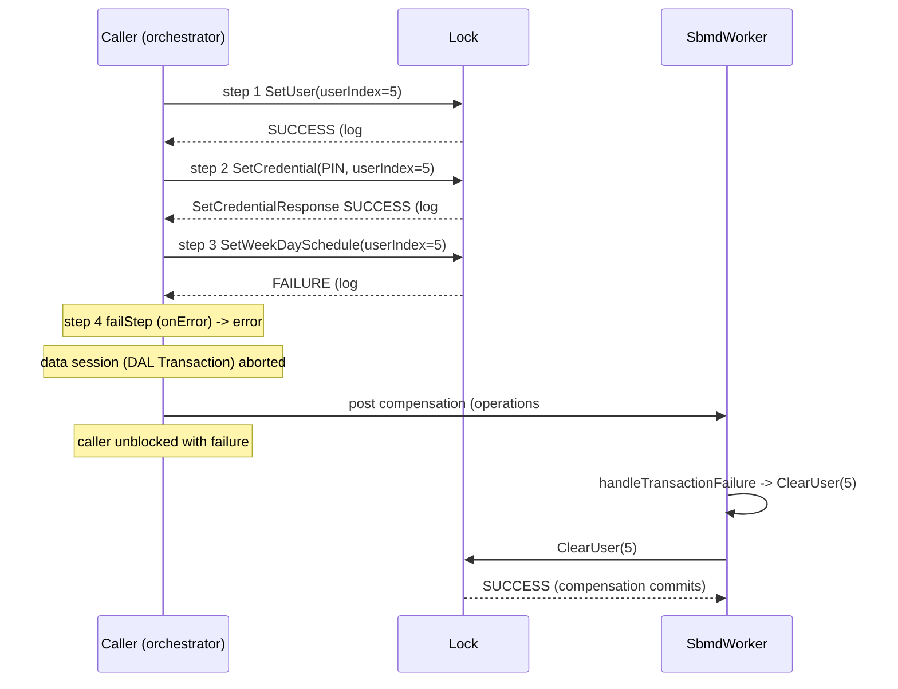

# Design: SBMD Transaction Failure Handler (BARTON-424)

Add an optional, driver-level `onTransactionFailure` handler that the runtime invokes exactly once for every failed SBMD Transaction, after the failing step's `onError` and after the failed DAL Transaction has been aborted, with the transaction's full operation log, the failure, the driver context, and freshly fetched supplements. Its result chain runs as a new SBMD Transaction with failure handling disabled.

## Context

Terminology (epic D1, see `openspec/changes/sbmd-dal-core/design.md`):

- **SBMD Transaction** — the driver-level execution of one request, from the initial handler invocation through every parked device operation and deferred callback, to the terminal result and, on failure, the failure handler. Code: `SbmdTransaction`.
- **DAL Transaction** — per-key routed reads, staged writes, commit or abort. Code: `DalTransaction`.

BARTON-423 introduces `SbmdTransaction`, its operation log (`SbmdOperationLog`), the `SbmdTransactionOrchestrator` step loop, `SbmdWorker`, and a failure hand-off hook, `SpecBasedMatterDeviceDriver::OnTransactionFailed(txn)`, which in BARTON-423 only logs. The orchestrator calls it after (a) the failing hop's `onError` has run as a step (when the failure was delivered to an armed hop), and (b) the transaction's data session (`SbmdDataSession`; with `DalSbmdDataAccess`, its `DalTransaction`) has been aborted. It then unblocks the caller. Under epic D12, an `onError` whose non-`error` terminal is honored has recovered the transaction, so the hand-off is never reached for it. Failure types produced by BARTON-423 are `timeout`, `commandFailed`, `readFailed`, `transport`, `internal`, `aborted`, and `commitFailed`; `commitFailed` carries a reason, including `conditionFailed` for a conditional-write mismatch (epic D11).

Delivery order (epic D13): BARTON-412 fix → 423 → 421 → 426 → 422 → **424** → 425. By the time this change lands, `DalSbmdDataAccess` has replaced the legacy data implementation. A handler's `error` terminal is classified as the type of the hop error it was handling (when returned from `onError`) or `internal`.

### How drivers declare handlers today

A driver is one `.sbmd.js` file calling `SbmdDriver({...})`. `SbmdLoader` (`core/deviceDrivers/matter/sbmd/mquickjs/SbmdLoader.cpp`) walks the registration object's properties directly. Resource handlers (`seed`, `read`, `write`, `execute`) accept either a bare function or an object `{ supplements: {...}, handler: fn }` (`SbmdLoader::ExtractResourceHandler`). Device handlers (`attributeHandlers`, `eventHandlers`, `commandHandlers`) are maps of named entries `{ aliases, supplements, handler }` (`ExtractDeviceHandlers`). Extracted handlers are `SbmdHandler` objects (`SbmdRegistration.h`) whose function reference is rooted in `heldFn`; `SbmdDriver::VisitHandlers` enumerates every handler to root it on `Activate` and release it on deactivate. The registration schema `core/deviceDrivers/matter/sbmd/schema/sbmd-spec-schema.json` has `"additionalProperties": false` at the top level and `schemaVersion` `const: "5.0"`. TypeScript typings for editors live in `scriptCommon/sbmd-script.d.ts`. `scriptCommon/` holds the JS runtime pieces (`sbmd-result.js` result builder, `sbmd-tlv.js`, etc.); no driver-level lifecycle hook exists today.

### Door Lock cluster facts used by the example

Door Lock cluster `0x0101`: `SetUser` `0x1A` (status-only response), `ClearUser` `0x1D` (status-only; per the Matter specification it also deletes every credential and schedule associated with the user), `SetCredential` `0x22` → `SetCredentialResponse` `0x23` (`Status`, `UserIndex`, `NextCredentialIndex`), `ClearCredential` `0x26` (status-only), `SetWeekDaySchedule` `0x0B` (status-only).

## References

- `openspec/changes/sbmd-transaction-orchestrator/design.md` — `SbmdTransaction`, operation log, step loop, failure hand-off, `SbmdWorker`.
- `openspec/changes/sbmd-dal-driver-api/` — Fresh supplements and driver data API used by the handler.
- Branch `BARTON-412-deferred-failure-callbacks` — `transport`/`internal` failure types and exactly-once `onError`.
- `docs/SBMD.md` — Registration object schema (§4), handler arguments (§5), command response flows (§6), result builder (§7).
- [Matter Door Lock cluster command list (matter-survey.org)](https://matter-survey.org/cluster/0x0101) — Command IDs and parameters used in the example.
- [Home Assistant Matter lock helpers](https://github.com/home-assistant/core/blob/dev/homeassistant/components/matter/lock_helpers.py) — Confirms that `ClearUser` clears the user's credentials and schedules.
- [Saga pattern (Garcia-Molina & Salem, 1987)](https://www.cs.cornell.edu/andru/cs711/2002fa/reading/sagas.pdf) — Compensating transactions for long-lived operations that cannot be rolled back atomically.

## Goals / Non-Goals

**Goals:**

- One optional driver-level `onTransactionFailure`, declared in the registration object.
- Exactly-once invocation for every failed SBMD Transaction and every failure type.
- Deterministic ordering relative to `onError`, data-session abort, and the caller.
- Recovery rule (epic D12): not invoked when `onError` recovered the transaction.
- `args.operations`, `args.failure`, `args.context` exactly as specified by the epic, plus fresh supplements.
- Compensation chain executed as a new SBMD Transaction with failure handling disabled.
- Schema, typings, loader, docs.

**Non-Goals:**

- Per-step `onFailure` hooks or a `CleanupRegistry` (dropped, epic D2).
- Automatic inverse operations.
- Recursion into `onTransactionFailure` from a failing compensation.
- Returning compensation results to the original caller.
- Status-only continuation for forward chains (open question).

## Decisions

### D1: Declaration — top-level `onTransactionFailure` entry

**Decision:** `onTransactionFailure` is an optional top-level property of the `SbmdDriver({...})` registration object. It accepts the same two forms as resource handlers: a bare function, or `{ supplements: {...}, handler: fn }`. A driver declares at most one. It is not per resource and not per step.

```js
// Example: core/deviceDrivers/matter/sbmd/specs/<driver>.sbmd.js
SbmdDriver({
    schemaVersion: '5.0',
    // ...
    onTransactionFailure: {
        supplements: { transientData: ['sessions'] },
        handler: handleTransactionFailure,
    },
});
```

Loader and registration changes:

```cpp
// core/deviceDrivers/matter/sbmd/SbmdRegistration.h (addition to SbmdRegistration)
        // Driver-level failure handler, invoked once per failed SBMD Transaction (BARTON-424).
        std::optional<SbmdHandler> onTransactionFailure;
```

```cpp
// core/deviceDrivers/matter/sbmd/mquickjs/SbmdLoader.cpp (after commandHandlers extraction)
        SafeJSValue failureVal(ctx, JS_GetPropertyStr(ctx, regVal.Get(), "onTransactionFailure"));

        if (!JS_IsUndefined(failureVal.Get()) && !JS_IsNull(failureVal.Get()))
        {
            reg->onTransactionFailure = ExtractResourceHandler(ctx, failureVal.Get());

            if (!reg->onTransactionFailure.has_value())
            {
                icError("Invalid onTransactionFailure in %s", filePath.c_str());
                return nullptr;
            }
        }
```

```cpp
// core/deviceDrivers/matter/sbmd/SbmdDriver.h (VisitHandlers, after commandHandlers)
            if (registration->onTransactionFailure.has_value())
            {
                fn(*registration->onTransactionFailure);
            }
```

Schema (`sbmd-spec-schema.json`), added to top-level `properties`:

```json
"onTransactionFailure": {
  "description": "Driver-level failure handler invoked once per failed SBMD Transaction. A function, or an object with 'handler' and optional 'supplements'.",
  "oneOf": [
    { "const": true },
    {
      "type": "object",
      "additionalProperties": false,
      "required": ["handler"],
      "properties": {
        "handler": { "const": true },
        "supplements": { "$ref": "#/$defs/supplements" }
      }
    }
  ]
}
```

The schema represents functions as `true` after extraction (per the schema's own description); the existing `$defs` supplements definition is reused (adjust the `$ref` name to the one already used by resource handlers).

Typings (`sbmd-script.d.ts`):

```ts
// core/deviceDrivers/matter/sbmd/scriptCommon/sbmd-script.d.ts
interface SbmdRegistration {
    // ...existing fields...
    /** Driver-level failure handler, invoked once per failed SBMD Transaction. */
    onTransactionFailure?: SbmdHandlerFunction | { supplements?: SbmdSupplements; handler: SbmdHandlerFunction };
}

interface SbmdOperationRecord {
    step: number;
    kind: 'command' | 'readAttribute' | 'writeAttribute';
    endpoint: number | null;
    cluster: number;
    command?: number;
    attribute?: number;
    /** Base64-encoded TLV payload supplied by the driver, or null. */
    request: string | null;
    status: 'succeeded' | 'failed' | 'notSent';
    /** Base64-encoded TLV command response or attribute value, when succeeded and present. */
    response?: string | null;
    error?: { type: string; message: string; matterCode: number | null };
}

interface SbmdTransactionFailure {
    step: number;
    type: 'timeout' | 'commandFailed' | 'readFailed' | 'transport' | 'internal' | 'aborted' | 'commitFailed';
    message: string;
    matterCode?: number | null;
}

interface SbmdTransactionFailureArgs extends SbmdHandlerArgsBase {
    operations: SbmdOperationRecord[];
    failure: SbmdTransactionFailure;
    context: any;
    resource?: { resourceId: string; input: string | null };
}
```

**Alternative considered:** A `lifecycle: { onTransactionFailure }` sub-object. Rejected — there is no other lifecycle hook today; a single top-level key matches how `attributeHandlers`/`eventHandlers` are declared and keeps the schema flat.

**Alternative considered:** Per-step `Sbmd.result().onFailure(fn)` hooks. Rejected by epic D2 — scattered, ordering-sensitive, and unable to see what other steps did.

**Trade-offs:** The schema `const: "5.0"` is unchanged because the field is optional and additive; whether to record it as 5.0 or bump to 5.1 is an open question (see Open Questions).

---

### D2: Invocation guarantees and ordering

**Decision:** `SpecBasedMatterDeviceDriver::OnTransactionFailed(txn)` (the BARTON-423 hand-off) invokes the handler when all of the following hold: the driver declares `onTransactionFailure`; `txn->FailureHandlingEnabled()` is true (false for compensation transactions); and the transaction reached the `Failed` state through `SbmdTransaction::TryFinish`, whose latch guarantees `OnTransactionFailed` is reached at most once per transaction. The ordering is:

1. The failing step's `onError`, if the failure was delivered to an armed hop, runs as a step of the failed transaction.
2. The failed transaction's data session (its DAL Transaction) is aborted (staged writes and attribute overlay discarded).
3. `onTransactionFailure` is invoked as step 1 of a new compensation SBMD Transaction (D4). Its supplements are fetched through the compensation transaction's own data session at that time.
4. The original caller is unblocked with the original failure.

Step 3 is scheduled on `SbmdWorker`; the orchestrator of the failed transaction posts the compensation transaction and proceeds to step 4 without waiting for it. "Invoked after X" therefore means "X has completed before the compensation transaction is posted".

Every failure path in BARTON-423 funnels through `Fail`, so every failure type reaches the hand-off: handler `error` terminal, device error, timeout, depth limit, pre-send failure, `aborted`, and `commitFailed`. For `commitFailed`, BARTON-421 has already attempted rollback of earlier-committed plugins; `args.failure.message` starts with the reason, for example `conditionFailed: transient/<key>` when a conditional write's expected value no longer matched (epic D11).

Recovery rule (epic D12): when a hop fails and its `onError` returns `success()` or a continuation that BARTON-423 honors (types `internal`, `transport`, `commandFailed`, `readFailed`), the transaction has recovered and never reaches `Fail`, so the handler does not run, even though the operation log contains a `failed` entry. If the continuation later fails, the transaction terminates in failure and the handler runs once. For `timeout` and depth-limit failures the recovery terminal is ignored (BARTON-412), so the handler runs.

```cpp
// core/deviceDrivers/matter/sbmd/SpecBasedMatterDeviceDriver.cpp
void SpecBasedMatterDeviceDriver::OnTransactionFailed(const std::shared_ptr<SbmdTransaction> &txn)
{
    const SbmdFailure &failure = *txn->failure;

    icWarn("SBMD transaction %" PRIu64 " failed at step %u (%s): %s",
           txn->Id(),
           failure.step,
           ToString(failure.type),
           failure.message.c_str());

    if (!txn->FailureHandlingEnabled())
    {
        metrics.RecordCompensationFailed(driver->GetDriverStem().c_str(), ToString(failure.type));
        return;
    }

    if (driver == nullptr || !driver->GetRegistration().onTransactionFailure.has_value())
    {
        return;
    }

    auto compensation = MakeCompensationTransaction(*txn);

    if (compensation == nullptr)
    {
        icError("Unable to create compensation transaction for %" PRIu64, txn->Id());
        metrics.RecordFailureHandlerSkipped(driver->GetDriverStem().c_str(), ToString(failure.type));
        return;
    }

    SbmdStepTrigger trigger;
    trigger.kind = SbmdStepTrigger::Kind::Initial;
    trigger.handler = &*driver->GetRegistration().onTransactionFailure;
    trigger.buildArgs = [snapshot = TransactionFailureSnapshot::From(*txn)](JSContext *ctx) {
        return SbmdHandlerInvoker::BuildTransactionFailureArgs(ctx, snapshot);
    };

    metrics.RecordFailureHandlerInvoked(driver->GetDriverStem().c_str(), ToString(failure.type));

    bool posted = SbmdWorker::Instance().Post([this, compensation, trigger = std::move(trigger)]() mutable {
        auto result = SbmdTransactionOrchestrator(*this, threadHop).Run(compensation, std::move(trigger));

        if (result.success)
        {
            metrics.RecordCompensationCommitted(driver->GetDriverStem().c_str());
        }
    });

    if (!posted)
    {
        icError("SbmdWorker stopped; onTransactionFailure for transaction %" PRIu64 " not run", txn->Id());
        metrics.RecordFailureHandlerSkipped(driver->GetDriverStem().c_str(), ToString(failure.type));
    }
}
```

`TransactionFailureSnapshot::From` copies the operation log, failure, handler context, resource trigger, and moves the driver context `SafeJSValue` out of the failed transaction (under the JS runtime mutex), so the compensation transaction does not keep the failed transaction alive.

**Alternative considered:** Run the handler synchronously on the failed transaction's orchestrator before unblocking the caller. Rejected — a compensation chain may involve several device round trips; holding a device-service caller (15 s budget) or a reporting path for them is worse than returning the failure promptly. The trade-off is that the caller can observe failure before compensation finishes.

**Trade-offs:** If `SbmdWorker` has been stopped (shutdown), the handler cannot run; this is logged and metered.

---

### D3: Arguments

**Decision:** `SbmdHandlerInvoker::BuildTransactionFailureArgs` builds:

| Field | Type | Description |
| --- | --- | --- |
| `args.deviceUuid` | `string` | Device of the failed transaction. |
| `args.endpointId` | `string \| null` | Endpoint of the failed transaction's originating handler. |
| `args.clusterFeatureMaps` | `{ [clusterId]: number }` | As for other handlers. |
| `args.resource` | `{ resourceId, input } \| undefined` | Present when the failed transaction originated from a resource read/write/execute or seed. |
| `args.operations` | `SbmdOperationRecord[]` | Ordered operation log of the failed transaction. |
| `args.failure` | `{ step, type, message, matterCode? }` | Why the transaction failed. `matterCode` present when a Matter error or status is known. |
| `args.context` | any | The driver context of the failed transaction: the `context` value supplied on its first deferred request (constant across the chain, as today), or `null`. |
| `args.supplements` | object | Declared supplements, fetched when the handler runs. |

Each `args.operations[i]`:

| Field | Type | Description |
| --- | --- | --- |
| `step` | number | Step number (1-based) in which the operation was requested. |
| `kind` | `"command" \| "readAttribute" \| "writeAttribute"` | `sendCommand`/`requestCommand` → `command`. |
| `endpoint` | number \| null | Resolved Matter endpoint; `null` if resolution failed. |
| `cluster` | number | Cluster ID. |
| `command` | number | Present for `command`. |
| `attribute` | number | Present for `readAttribute`/`writeAttribute`. |
| `request` | string \| null | Base64 TLV payload as supplied by the driver. |
| `status` | `"succeeded" \| "failed" \| "notSent"` | Outcome. |
| `response` | string \| null | Present when `succeeded`: base64 TLV command response (or `null` for a status-only success) or attribute value. |
| `error` | `{ type, message, matterCode }` | Present when `failed` or `notSent` because of a pre-send failure. |

`args.failure.type` values: `timeout`, `commandFailed`, `readFailed`, `transport`, `internal`, `aborted`, `commitFailed`.

```cpp
// core/deviceDrivers/matter/sbmd/mquickjs/SbmdHandlerInvoker.h (addition)
        /**
         * Build args for onTransactionFailure: common fields, optional resource trigger, operations,
         * failure, and context. Supplements are attached separately via AddSupplements.
         */
        static SafeJSValue BuildTransactionFailureArgs(JSContext *ctx, const TransactionFailureSnapshot &snapshot);
```

**Alternative considered:** Pass only the failing step. Rejected — compensation needs what earlier steps did (user index from step 1, credential from step 2).

**Trade-offs:** Payloads stay base64 TLV; drivers decode with `Sbmd.Tlv.decode` as they do for responses today.

---

### D4: Compensation runs as a new SBMD Transaction with failure handling disabled

**Decision:** `MakeCompensationTransaction(failed)` creates an `SbmdTransaction` with origin `Compensation`, a new data session (`SbmdDataAccess::Begin`), the same device and handler context, `failureHandlingEnabled = false`, and a fresh overall deadline (`matter.defaultTimeoutMs` or 30 s). The handler is step 1 of that transaction. Its result is processed like any other step: `log` immediately; data writes staged and committed if the compensation succeeds; terminal `success` commits; `sendCommand`/`writeAttribute`/`requestCommand`/`readAttribute` perform device operations, logged in the compensation's own operation log; deferred hops may chain. Because the worker has no pre-established session, the first device terminal of a compensation transaction acquires a CASE session through the same connection path as `ConnectAndOrchestrate` (BARTON-423 D8), bounded by the compensation deadline.

If the compensation transaction fails for any reason, `OnTransactionFailed` sees `FailureHandlingEnabled() == false`, logs the failure (with the compensation's operation log at `warn`), records `sbmd.txn.compensation_failed{driver,type}`, and stops. `onTransactionFailure` is never invoked for a compensation transaction.

If the handler itself throws or returns no result, the compensation transaction fails with `internal` and is logged the same way.

**Alternative considered:** Stage compensation writes in the failed transaction's data session. Rejected — that transaction has been aborted (ordering rule), and mixing intents would defeat discard-on-failure.

**Alternative considered:** Allow nested failure handling with a depth limit. Rejected — a failing compensation usually means the device is unreachable; retrying compensation of compensation adds risk without benefit.

**Trade-offs:** Compensation is best effort. Drivers that need guaranteed cleanup must also tolerate leftovers at the next operation (for example, by checking state on the next attempt).

---

### D5: `aborted` failures

**Decision:** The handler runs for `aborted` transactions with `args.failure.message` naming the reason (`"device removed"`, `"plugin unregistered: <scope>"`, `"driver deactivated"`, `"shutdown"`). For `device removed`, device terminals in the compensation will fail immediately (no device), but data writes still commit, which lets a driver clean up driver state about the device. For `driver deactivated` and `shutdown`, the driver's handler references are about to be released and `SbmdWorker` is stopping: the runtime invokes the handler only if the worker accepts the post and the driver is still activated when the worker runs it; otherwise the skip is logged and metered (`sbmd.txn.failure_handler_skipped{driver,type}`).

**Alternative considered:** Never run the handler for `aborted`. Rejected by epic D5, which requires all failure types to be covered; device-removed cleanup of driver data is a real need (camera sessions).

**Trade-offs:** Shutdown-time compensation is not guaranteed.

## Data Structures

### Inputs

`TransactionFailureSnapshot` (internal):

```cpp
// core/deviceDrivers/matter/sbmd/txn/TransactionFailureSnapshot.h
#pragma once

#include "SbmdOperationLog.h"
#include "SbmdTransaction.h"

#include <optional>
#include <string>

namespace barton
{
    struct TransactionFailureSnapshot
    {
        HandlerContext handlerContext;                    // deviceUuid, endpointId, clusterFeatureMaps
        std::optional<std::string> resourceId;            // present for resource-origin transactions
        std::optional<std::string> resourceInput;
        std::vector<SbmdOperationRecord> operations;
        SbmdFailure failure;
        SafeJSValue context;                              // moved from the failed transaction; may be empty

        /** Copy everything; move the driver context out of the failed transaction (JS mutex held by caller). */
        static TransactionFailureSnapshot From(SbmdTransaction &failed);
    };
} // namespace barton
```

### Outputs

The handler returns an `Sbmd.result()` chain; nothing new.

## Interfaces

No public C API, GObject, signal, property, or GIR changes. Driver-facing interface (JavaScript):

| Element | Form | Description |
| --- | --- | --- |
| `onTransactionFailure` | `fn` or `{ supplements?, handler: fn }` | Top-level registration property. Optional. |
| `args.operations` | array | Operation log of the failed SBMD Transaction. |
| `args.failure` | object | `{ step, type, message, matterCode? }`. |
| `args.context` | any | Driver context of the failed transaction, or `null`. |
| Return | `Sbmd.result()` chain | Runs as a compensation SBMD Transaction. |

Internal C++: `SbmdRegistration::onTransactionFailure`, `SbmdHandlerInvoker::BuildTransactionFailureArgs`, `TransactionFailureSnapshot`, `SpecBasedMatterDeviceDriver::OnTransactionFailed` (body), `MakeCompensationTransaction`.

### Threads

```text
  failed txn orchestrator            glibEvt main loop          Matter thread           SbmdWorker
  -----------------------            -----------------          -------------           ----------
  onError step (if any) ---------------------------------------> JS onError
  SbmdDataSession::Abort ---------->  discard staged writes (DalTransaction::Abort)
  OnTransactionFailed: snapshot, Post(compensation) ---------------------------------->  queue
  unblock caller (original failure)
                                                                                        Run(compensation):
                                      Read(supplements) <------------------------------  step 1
                                                                 JS onTransactionFailure <-
                                      Stage(writes)  <---------------------------------
                                                                 ClearUser (device op) <---
                                      Commit / Abort <---------------------------------  finish (no recursion)
```

The same wait-direction rule as BARTON-423 applies: `SbmdWorker` is an orchestrator; it waits on the main loop and the Matter thread; the Matter thread never waits.

## Implementation Detail

### Worked example — door lock user provisioning

A driver execute handler provisions a user, a PIN credential, and a week-day schedule in three steps. Step 3 fails; `onTransactionFailure` uses the operation log to remove what steps 1 and 2 created. The forward chain uses a status-only continuation after `SetUser` and `SetWeekDaySchedule`, which the runtime does not support today (Open Questions, Q1); the example writes it as `requestCommand` with `responseCommandId` omitted. The failure handler itself uses only existing features.

```js
// Illustrative: door-lock user provisioning with compensation
var CL_DOOR_LOCK = 0x0101;
var CMD_SET_WEEK_DAY_SCHEDULE = 0x0B;
var CMD_SET_USER = 0x1A;
var CMD_CLEAR_USER = 0x1D;
var CMD_SET_CREDENTIAL = 0x22;
var CMD_SET_CREDENTIAL_RESP = 0x23;
var DL_STATUS_SUCCESS = 0x00;

SbmdDriver({
    // ...
    endpoints: {
        '1': {
            resources: {
                addUser: { type: 'json', modes: ['execute'], execute: executeAddUser },
            },
        },
    },
    onTransactionFailure: handleTransactionFailure,
});

// Step 1: SetUser (OperationType Add = 0) at the requested index.
function executeAddUser(args) {
    var req = JSON.parse(args.resource.input); // { userIndex, name, pin, schedule: {...} }
    var payload = Sbmd.Tlv.encodeStruct(
        { OperationType: 0, UserIndex: req.userIndex, UserName: req.name, UserUniqueID: null,
          UserStatus: null, UserType: null, CredentialRule: null },
        { OperationType: { tag: 0, type: 'enum8' }, UserIndex: { tag: 1, type: 'uint16' },
          UserName: { tag: 2, type: 'string' }, UserUniqueID: { tag: 3, type: 'uint32' },
          UserStatus: { tag: 4, type: 'enum8' }, UserType: { tag: 5, type: 'enum8' },
          CredentialRule: { tag: 6, type: 'enum8' } });

    return Sbmd.result().device.requestCommand(CL_DOOR_LOCK, CMD_SET_USER, payload, {
        // responseCommandId omitted: continue on success status (Q1)
        onResponse: setCredential,
        onError: failStep,
        context: req,
        timedInvokeTimeoutMs: 10000,
    });
}

// Step 2: SetCredential (PIN) for that user; response 0x23 carries Status.
function setCredential(args) {
    var req = args.handlerContext;
    // SetCredential's Credential field is a nested struct, which Sbmd.Tlv.encodeStruct's flat schema does not
    // describe; the payload builder is driver code (BARTON-425) and is elided here.
    var payload = buildSetCredentialPayload(req.userIndex, req.pin);

    return Sbmd.result().device.requestCommand(CL_DOOR_LOCK, CMD_SET_CREDENTIAL, payload, {
        responseCommandId: CMD_SET_CREDENTIAL_RESP,
        onResponse: setSchedule,
        onError: failStep,
        timedInvokeTimeoutMs: 10000,
    });
}

// Step 3: SetWeekDaySchedule. In the scenario, the lock rejects it.
function setSchedule(args) {
    var resp = Sbmd.Tlv.decode(args.response.data);

    if (resp[0] !== DL_STATUS_SUCCESS) {
        return Sbmd.result().error('SetCredential status ' + resp[0]);
    }

    var req = args.handlerContext;
    var s = req.schedule;
    var payload = Sbmd.Tlv.encodeStruct(
        { WeekDayIndex: 1, UserIndex: req.userIndex, DaysMask: s.daysMask,
          StartHour: s.startHour, StartMinute: s.startMinute, EndHour: s.endHour, EndMinute: s.endMinute },
        { WeekDayIndex: { tag: 0, type: 'uint8' }, UserIndex: { tag: 1, type: 'uint16' },
          DaysMask: { tag: 2, type: 'uint8' }, StartHour: { tag: 3, type: 'uint8' },
          StartMinute: { tag: 4, type: 'uint8' }, EndHour: { tag: 5, type: 'uint8' },
          EndMinute: { tag: 6, type: 'uint8' } });

    return Sbmd.result().device.requestCommand(CL_DOOR_LOCK, CMD_SET_WEEK_DAY_SCHEDULE, payload, {
        // responseCommandId omitted: continue on success status (Q1)
        onResponse: function () { return Sbmd.result().success(); },
        onError: failStep,
        timedInvokeTimeoutMs: 10000,
    });
}

function failStep(args) {
    return Sbmd.result().log('add user step failed: ' + args.error.message).error(args.error.message);
}

// Runs once, after failStep, after the failed transaction's staged writes were discarded.
function handleTransactionFailure(args) {
    var setUser = null;
    var setCredential = null;

    for (var i = 0; i < args.operations.length; i++) {
        var op = args.operations[i];

        if (op.kind !== 'command' || op.cluster !== CL_DOOR_LOCK || op.status !== 'succeeded') {
            continue;
        }

        if (op.command === CMD_SET_USER) {
            setUser = op;
        } else if (op.command === CMD_SET_CREDENTIAL) {
            setCredential = op;
        }
    }

    if (setUser === null && setCredential === null) {
        return Sbmd.result().log('add user failed before any change: ' + args.failure.type).success();
    }

    // UserIndex is context tag 1 of the SetUser request (and tag 3 of SetCredential).
    var userIndex = setUser !== null ? Sbmd.Tlv.decode(setUser.request)[1] : Sbmd.Tlv.decode(setCredential.request)[3];

    // ClearUser deletes the user and every credential and schedule associated with it, so one command
    // compensates both step 1 and step 2.
    var payload = Sbmd.Tlv.encodeStruct({ UserIndex: userIndex }, { UserIndex: { tag: 0, type: 'uint16' } });

    return Sbmd.result()
        .log('compensating add user ' + userIndex + ' after ' + args.failure.type + ' at step ' + args.failure.step)
        .device.sendCommand(CL_DOOR_LOCK, CMD_CLEAR_USER, payload, { timedInvokeTimeoutMs: 10000 });
}
```

Sequence for the failure scenario:



If `ClearUser` fails, the compensation transaction fails, the failure is logged with its own operation log, and nothing further runs. The scenario is implemented as a unit test with a test-only driver and a fake device; BARTON-425 adds the integration scenario.

### Metrics

`sbmd.txn.failure_handler_invoked{driver,type}`, `sbmd.txn.failure_handler_skipped{driver,type}`, `sbmd.txn.compensation_committed{driver}`, `sbmd.txn.compensation_failed{driver,type}`.

## Migrations

Delivery order (epic D13): BARTON-412 fix → 423 → 421 → 426 → 422 → **424** → 425. `sbmd-v4-runtime` archive order: 423 → 422 → 424. The registration field is optional; no existing driver or schema-validated spec changes. The `sbmd-v4-runtime` delta restates "Registration object extraction" in full.

## Testing Philosophy

### Loader and schema

Load drivers declaring `onTransactionFailure` as a bare function, as `{ handler }`, and as `{ supplements, handler }`; verify extraction, rooting on activate, release on deactivate. Reject a non-function `handler`. Validate a driver using the field against `sbmd-spec-schema.json`, and confirm that drivers without it still validate.

### Invocation guarantees

With the BARTON-423 fake `ThreadHop`, fake `SbmdDataAccess`, and fake device, cause each failure type — handler `error`, device failure, per-hop timeout, overall deadline, depth limit, endpoint failure (`internal`), send rejection (`transport`), device removal (`aborted`), plugin unregister (`aborted`), commit failure (`commitFailed`, including reason `conditionFailed`) — and assert exactly one invocation with the correct `args.failure`. Assert no invocation for committed transactions or drivers without the handler.

### Ordering

Record the sequence of `onError` invocation, data-session abort, handler invocation, and caller unblock; assert `onError` → abort → post → unblock, and that the handler sees none of the failed transaction's staged writes in its supplements while it does see values committed by other transactions in the meantime.

### Recovery rule

An `onError` returning `success()` after `transport` → no invocation and the transaction commits; an `onError` returning a continuation that succeeds → no invocation; a continuation that later fails → exactly one invocation with the later failure; `success()` after `timeout` (ignored by BARTON-412) → exactly one invocation with `timeout`.

### Arguments

Assert `args.operations` matches the log for mixed chains (command, readAttribute, writeAttribute; succeeded, failed, notSent), including endpoint `null` on resolution failure and `response` payloads. Assert `args.context` equals the deferred `context` and is `null` when none was supplied, and `args.resource` presence by origin.

### Compensation

Handler returning `success` with data writes commits them; returning `sendCommand` sends it and commits on success; a failing compensation is logged, metered, and does not invoke the handler again; a throwing handler fails the compensation with `internal`.

### Door-lock scenario

Implement the worked example with a test driver (the forward chain's status-only steps are simulated by fake response commands until Q1 is resolved) and assert that exactly one `ClearUser` with the user index from step 1 is sent after step 3 fails.

## Documentation Plan

### `docs/SBMD.md`

**Audience:** SBMD driver authors.

Add `onTransactionFailure` to the §3 file-structure skeleton and the §4.1 top-level fields table. Add a new section "Transaction failure handler" (after §6) covering: what an SBMD Transaction is; when the handler runs (exactly once per failed transaction, every failure type, never for compensation); ordering relative to `onError`, discarded writes, and the caller; the `args.operations`, `args.failure`, `args.context` tables from this design; that supplements are fetched when the handler runs; that its result chain runs as a new transaction whose failure is logged and not retried; shutdown caveats for `aborted`; and the door-lock example. Update §5.1 (trigger-field table: add the failure-handler row), §5.2 (handler type summary: add "Transaction failure handler"), and §6.2 runtime behavior (point to the new section for compensation of earlier steps).

### `core/deviceDrivers/matter/sbmd/schema/CHANGELOG.md`

**Audience:** SBMD driver authors and tooling maintainers.

Record the new optional top-level `onTransactionFailure` property under the version chosen for Q2.

## Risks / Trade-offs

### Caller sees failure before compensation completes

**Risk:** A client may retry immediately and race with the compensating `ClearUser`.

**Mitigation:** `SbmdWorker` is FIFO and device-initiated work is serialized behind the compensation; drivers should tolerate leftovers on retry. Documented in `docs/SBMD.md`.

### Compensation fails

**Risk:** The device is unreachable and leftovers remain (user without schedule).

**Mitigation:** Logged with operation logs and metered; no recursion. Drivers can reconcile at the next operation. Automatic retry is out of scope.

### Large operation logs

**Risk:** Long chains with large payloads increase memory held until the handler runs.

**Mitigation:** Depth limit (10 hops) bounds the log; payloads are released when the compensation transaction ends.

### Drivers relying on onError writes

**Risk:** After BARTON-423, data written in `onError` is discarded when the transaction fails; drivers that used `onError` for state cleanup lose it.

**Mitigation:** This handler is the replacement; BARTON-425 migrates the camera driver to release streams and session state here.

## Open Questions

- **Q1 — Status-only continuation.** `requestCommand` requires `responseCommandId`, so a chain cannot continue after a status-only command (`SetUser`, `SetWeekDaySchedule`, `ClearCredential`). The forward path of the door-lock example needs this. Options: make `responseCommandId` optional (continue on success status with `args.response.data = null`), or add a new terminal. Not in BARTON-423/424 scope as written.
- **Q2 — Schema version.** Keep `schemaVersion` `"5.0"` for an additive optional field, or bump to `"5.1"` (which would require every spec to change or the schema to accept both).
- **Q3 — `args.context` meaning.** This design uses the `context` supplied on the transaction's first deferred request (constant across the chain). Confirm that is the intended "driver context", versus a separate driver-level context object.
- **Q4 — Shutdown/deactivation.** Whether compensation at shutdown should be attempted synchronously before JS roots are released, or skipped (current design: best effort via `SbmdWorker`, skipped and metered if the worker has stopped).
